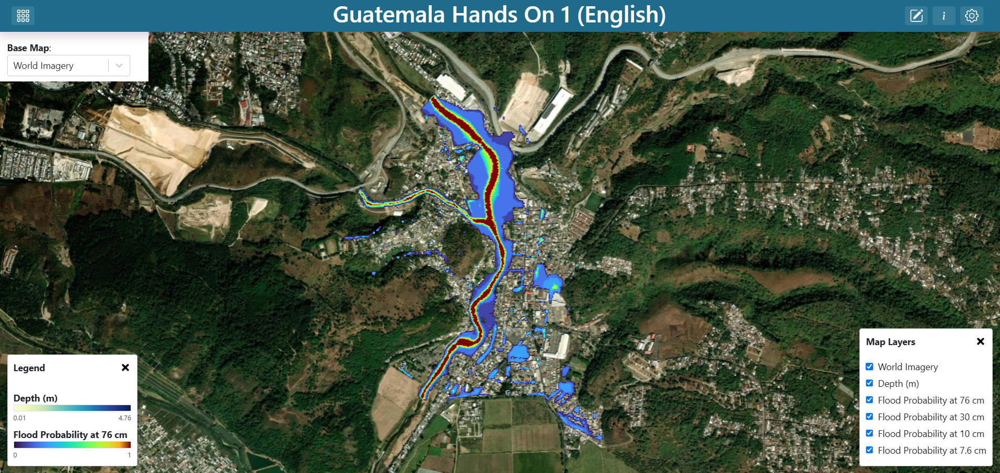
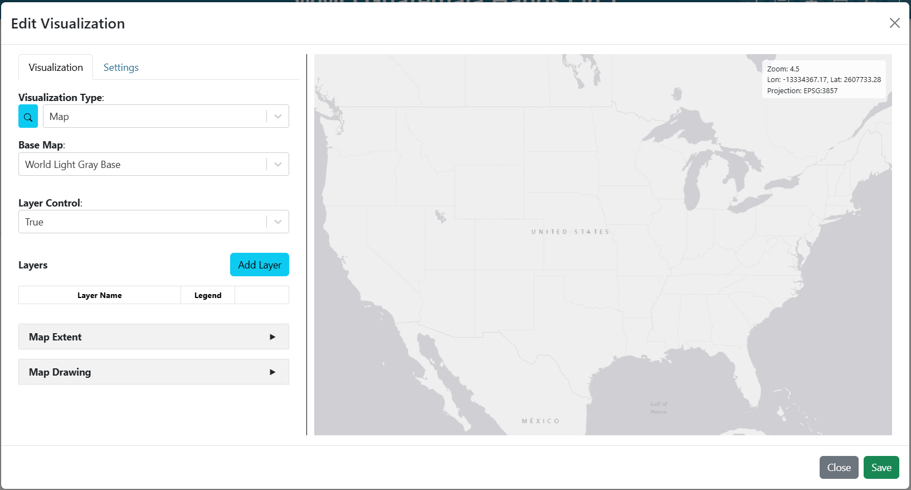
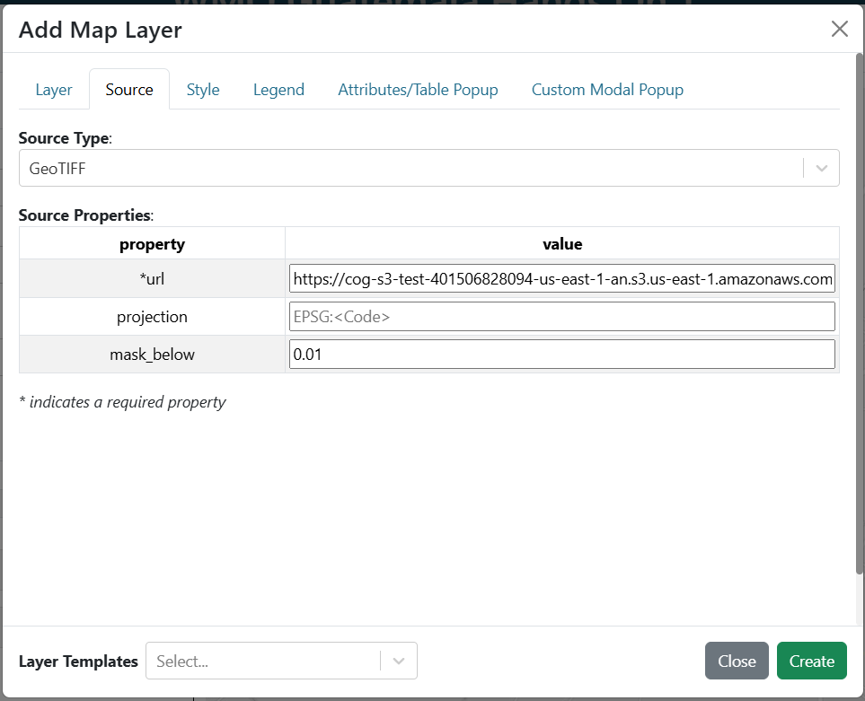
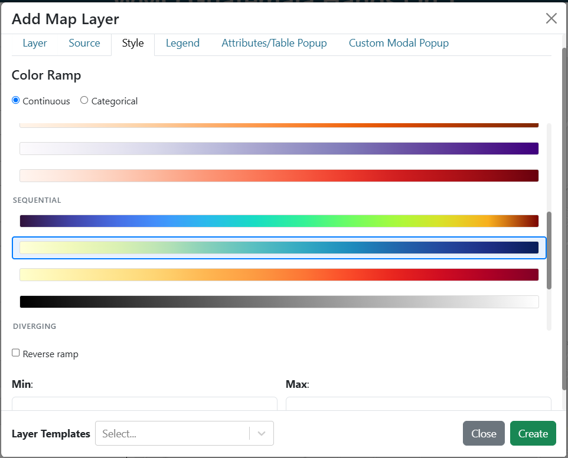
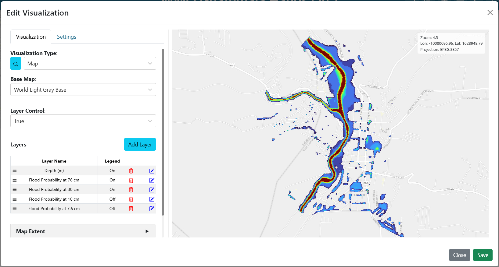
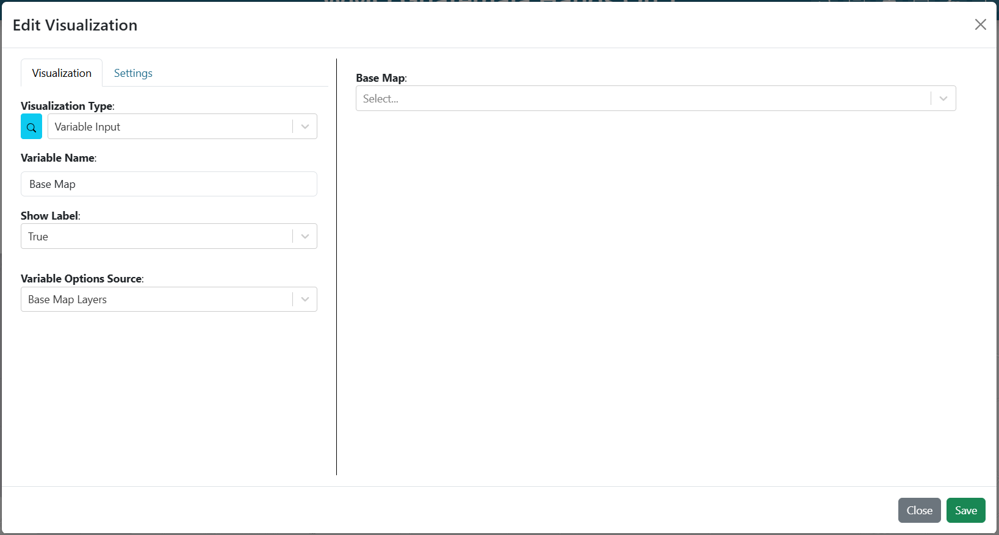
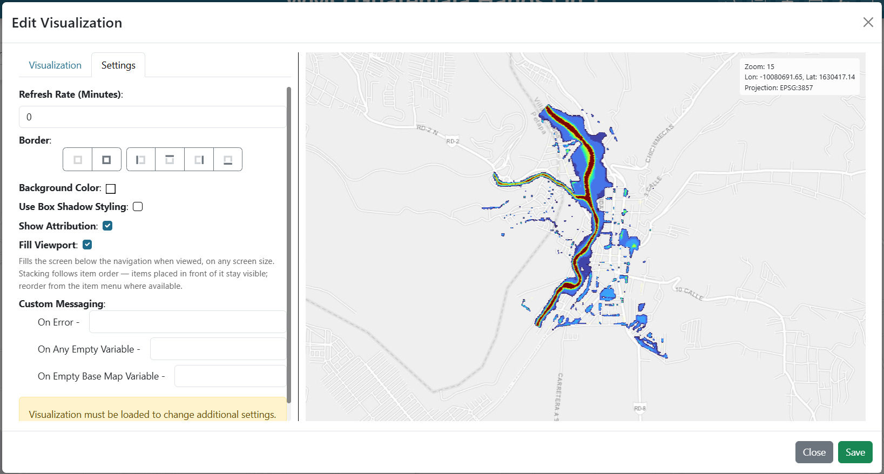

.. Guatemala hands-on exercise 1 solution, English. A Spanish translation lives
.. alongside this file as exercise_1_es.rst.

==============================================================
Exercise 1: A flood probability map
==============================================================

Building **Guatemala Hands On 1 (English)** step by step.

.. contents:: On this page
   :depth: 2
   :local:
   :backlinks: none

What you are building
=====================

One map filling the window, carrying four raster layers (the probability that
flood water reaches 10, 30, 70 and 100 cm) and a small dropdown in the top-left
corner that switches the base map underneath them. The rasters come from the
TITO sample cycle of 2026-10-16 22:00 UTC for Santa Inés Petapa; see
`The data <getting_started_en.rst#the-data>`_.

   **Screenshot:** the finished dashboard, layer control open so all four
   probability layers are visible.

This exercise is about raster layers: where the URL goes, how a colour ramp is
chosen, and why a probability ramp is pinned to a fixed scale instead of being
left for the app to scale.

Step 1: Create the dashboard
============================
#. Create a new dashboard (see
   `Creating a dashboard <getting_started_en.rst#creating-a-dashboard>`_) with:

   * **Name**: ``Guatemala Hands On 1 (English)``
   * **Description**: ``Solution for WMO Guatemala Hands On Exercise #1``

#. Find your dashboard on the landing page and double-click it to open. The
   dashboard is empty, so the preview shows a blank canvas.

#. Open **Dashboard Settings** in the top-right corner, and turn on
   **Unrestricted Grid Item Movement**. Save the settings.

#. Exit **Dashboard Settings** and click **Edit Dashboard** in the top-right
   corner to enter edit mode.

Step 2: Add the map
===================

#. You will see an existing item on the dashboard. Click on the item's 3-dot
   menu and select **Edit**.

#. Set the **Visualization Type** to **Map** (in the **Default** group).

#. Five arguments appear: **Base Map**, **Layer Control**, **Layers**,
   **Map Extent** and **Map Drawing**. Leave them for now; you will fill them
   over the next steps.

#. In the **Base Map** argument, choose ``World Light Gray Base`` for now. You
   will update this to be dynamic in a later step.

   **Screenshot:** the **Map** visualization's five arguments, with a default
   base map selected.

Step 3: Add the four probability layers
=======================================

These four layers are identical except for the URL and the name, so build one
and repeat. Add them in this order, so the deepest threshold ends up lowest in
the stack and the shallowest (which covers the largest area) ends up on top:

.. list-table::
   :header-rows: 1
   :widths: 34 66

   * - Layer **Name**
     - ``url``
   * - ``Flood Probability at 100 cm``
     - ``https://tito.uffis.org/sample/guatemala/20261016.220000/guatemala_90m/fim/stream_sat_stormlab/Guatemala_SantaInesPetapa/combined_overbank/prob_depth_ge_100cm_overbank.20261016.220000.tif``
   * - ``Flood Probability at 70 cm``
     - ``https://tito.uffis.org/sample/guatemala/20261016.220000/guatemala_90m/fim/stream_sat_stormlab/Guatemala_SantaInesPetapa/combined_overbank/prob_depth_ge_70cm_overbank.20261016.220000.tif``
   * - ``Flood Probability at 30 cm``
     - ``https://tito.uffis.org/sample/guatemala/20261016.220000/guatemala_90m/fim/stream_sat_stormlab/Guatemala_SantaInesPetapa/combined_overbank/prob_depth_ge_30cm_overbank.20261016.220000.tif``
   * - ``Flood Probability at 10 cm``
     - ``https://tito.uffis.org/sample/guatemala/20261016.220000/guatemala_90m/fim/stream_sat_stormlab/Guatemala_SantaInesPetapa/combined_overbank/prob_depth_ge_10cm_overbank.20261016.220000.tif``

(More information about the data is in
`The data <getting_started_en.rst#the-data>`_.)

For **each** of the four:

#. Next to **Layers**, click **Add Layer**. The layer editor opens with tabs
   **Layer**, **Source**, **Style**, **Legend**, **Attributes/Table Popup** and
   **Custom Modal Popup**.

#. On the **Layer** tab, set the following properties:

   .. list-table::
      :header-rows: 1
      :widths: 24 76

      * - Field
        - Value
      * - ``name``
        - *see the table above*

#. On the **Source** tab, set **Source Type** to **GeoTIFF** and fill in:

   .. list-table::
      :header-rows: 1
      :widths: 24 76

      * - Field
        - Value
      * - ``url``
        - *see the table above*
      * - ``mask_below``
        - ``0``

   ``mask_below`` hides cells at or below the value given. Zero means "no
   ensemble member floods here", and without the mask the whole domain would be
   painted the ramp's low colour instead of showing the base map.

#. On the **Style** tab, leave the mode on **Continuous** and pick the
   **turbo** ramp. Set **Min** = ``0`` and **Max** = ``1``.

   Pinning Min and Max to 0-1 is the whole point of these four layers.
   Probability has a fixed, meaningful range, and all four layers must use the
   same one or they cannot be compared.

   Leaving **Min** and **Max** empty would mean "resolve them from the file's
   statistics at render time", so each layer would stretch its ramp over
   whatever range that particular raster holds. That suits a quantity whose
   range belongs to the event, such as depth, but not probability: on a cycle
   where one depth never got above, say, 0.3, its ramp would paint 0.3 in the
   colour the other layers use for 1.0.

#. If setting up the first layer, on the **Legend** tab, select **Default
   Legend**. For a ramp-styled raster the app generates a colour bar
   automatically.

   Only the first probability layer needs its legend enabled; the four share a
   scale, so four identical colour bars would just take up room. In the shipped
   solution the 100 cm layer carries the legend and the other three have none.

#. Save the layer by clicking **Create** at the bottom of the layer editor.

#. Save the map item by clicking **Save** in the bottom-right corner of the map
   editor.

#. Resize the map item to fill the window by dragging the handle in its
   bottom-right corner.

#. Save the dashboard by clicking **Save Changes** in the top-right corner of
   the dashboard editor.

   **Screenshot:** the **Source** tab with **Source Type** GeoTIFF, the 100 cm
   probability URL, and ``mask_below`` 0.

   **Screenshot:** the **Style** tab, **Continuous** mode, **turbo** selected,
   **Min** 0 and **Max** 1.

   **Screenshot:** the **Layers** list with all four layers in order.

Step 4: Add the base map selector
=================================

The base map is a variable input so the viewer can switch it without editing
anything. Build the input first, then point the map at it.

#. Set the dashboard in edit mode by clicking on the **Edit Dashboard** button
   in the top-right corner.

#. Add another item by clicking **Add Dashboard Item** in the top-right corner.

#. Click on the 3-dot menu of the new item and select **Edit**.

#. Set the **Visualization Type** to **Variable Input** (in the **Default**
   group).

#. Fill in:

   .. list-table::
      :header-rows: 1
      :widths: 32 68

      * - Argument
        - Value
      * - ``variable_name``
        - ``Base Map``
      * - ``show_label``
        - ``True``
      * - ``variable_options_source``
        - ``Base Map Layers``

   ``Base Map Layers`` is a built-in options source: it fills the dropdown with
   the base maps the instance offers, so you do not enumerate them yourself.

#. On the **Settings** tab, set **Background Color** to ``#ffffff``. Without it
   the dropdown floats on the map with no backing and is hard to read.

#. Select an initial value for the dropdown from the preview on the right side
   of the editor. The shipped solution uses ``World Imagery``, but any base
   map is fine.

#. Save the item by clicking **Save** in the bottom-right corner of the item
   editor.

#. Drag the item to the top-left corner over the map and resize it as needed.

#. Save the dashboard by clicking **Save Changes** in the top-right corner of
   the dashboard editor.

   You now have a base map selector on the dashboard, but it does not yet
   control the map.

   **Screenshot:** the **Variable Input** arguments for the base map selector.

Step 5: Update the map's base map, extent and viewport
======================================================

#. Set the dashboard in edit mode by clicking on the **Edit Dashboard** button
   in the top-right corner.

#. Click on the 3-dot menu of the map item and select **Edit**.

#. In the **Base Map** argument, choose ``Base Map`` from the **Variable
   Inputs** section at the bottom of the dropdown. The value becomes ``${Base
   Map}``.

   See `Referencing a variable input
   <getting_started_en.rst#referencing-a-variable-input>`_ for the two forms
   this reference can take.

#. In the **Map Extent** argument, choose **Use a Custom Extent** and enter:

   .. code-block:: text

      -10078437.52,1629645.07,15

   That is ``centre-x,centre-y,zoom`` in EPSG:3857 metres.

#. On the **Settings** tab, turn on **Fill Viewport** so the map occupies the
   whole window.

#. Save the item by clicking **Save** in the bottom-right corner of the map
   editor.

#. Save the dashboard by clicking **Save Changes** in the top-right corner of
   the dashboard editor.

   **Screenshot:** the **Settings** tab with **Fill Viewport** on.

Checkpoint
==========

You should now have:

* A map filling the window, showing the Santa Inés Petapa site.
* A layer control listing five layers (the four probability layers and the base
  map); toggling each changes what is drawn.
* A legend control with a single colour bar for probability.
* A base-map dropdown top-left that changes the imagery underneath.

Talking points
==============

* **Pinned versus auto-scaled ramps.** Probability is pinned to 0-1 because the
  range is fixed by definition and the four layers must be comparable. An
  auto-scaled ramp suits a quantity whose range belongs to the event, such as
  depth. This is the single most transferable idea in the exercise.
* **What** ``mask_below`` **is for.** Rasters usually encode "nothing here" as a
  real number, and unless you mask it the ramp will faithfully colour the whole
  domain. For probability that number is ``0``: no ensemble member floods the
  cell.
* **What the numbers are.** Each value is the fraction of 50 ensemble members
  that put at least that depth of water on the cell, so every value is a
  multiple of 0.02. A cell's probability can only fall as the depth rises, which
  is why the 10 cm layer covers the most ground and the 100 cm layer the least.
* **Layer order is draw order.** The first layer in the list draws lowest, just
  above the base map, and each later one paints over it. The deepest threshold
  goes in first and so sits at the bottom; turn the upper layers off to see the
  deeper ones underneath.
* **The projection constraint.** All four rasters are natively EPSG:3857. See the
  warning in `The data <getting_started_en.rst#the-data>`_; this comes up again
  in exercise 3, where getting it wrong makes layers appear and then vanish.

Item positions
==============

The shipped solution places its items as follows, on the 100-column grid:

.. list-table::
   :header-rows: 1
   :widths: 40 15 15 15 15

   * - Item
     - ``x``
     - ``y``
     - ``w``
     - ``h``
   * - Map
     - 0
     - 0
     - 99
     - 41
   * - Base Map input
     - 0
     - 0
     - 15
     - 5

Next
====

`Exercise 2: Likely impact for a forecast cycle <exercise_2_en.rst>`_ adds a
plugin-backed vector layer and a data-driven selector to what you have just
built.
