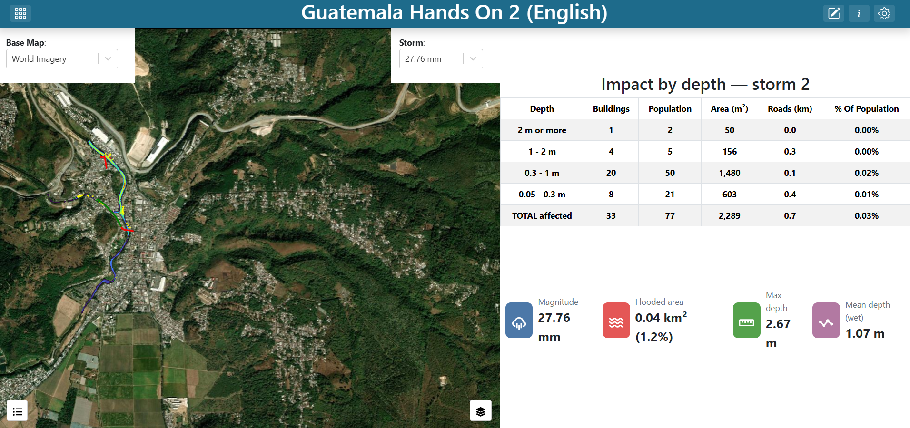
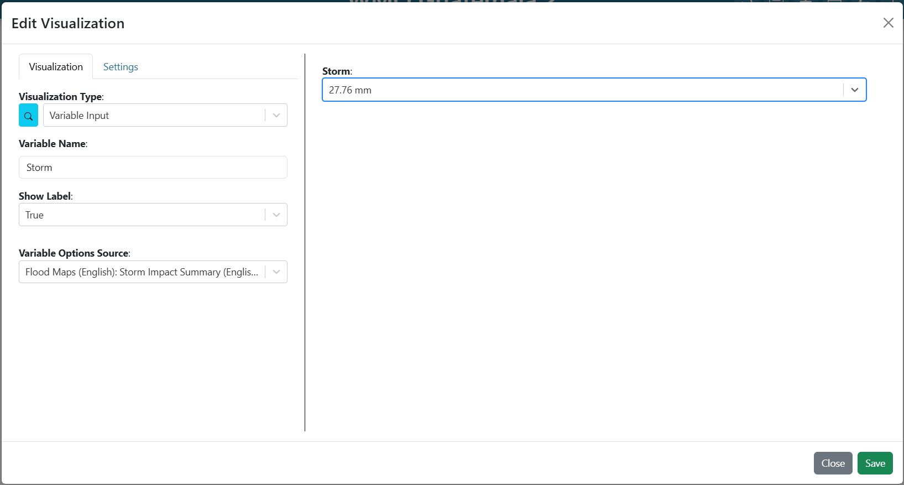
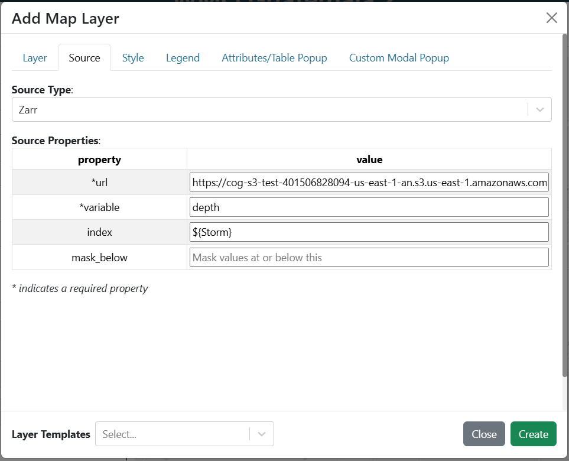
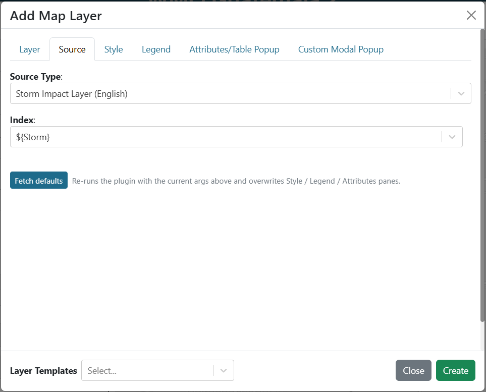
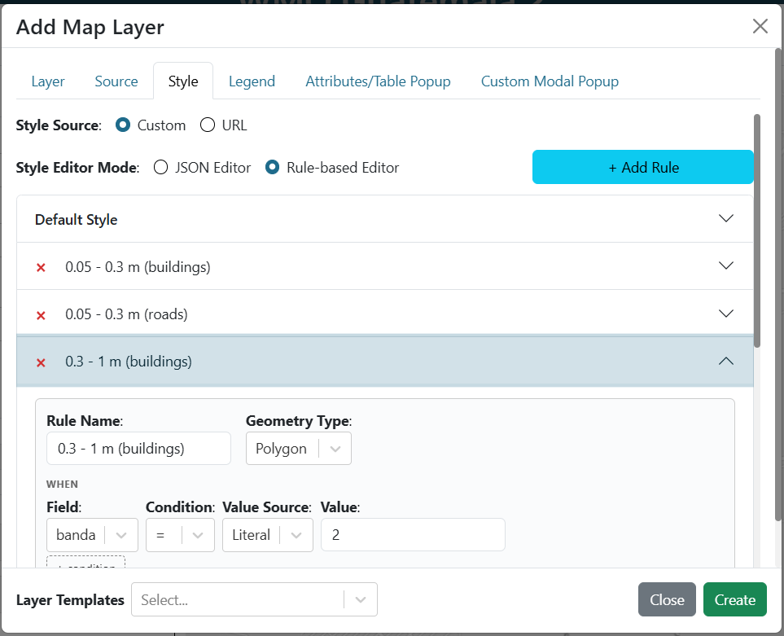
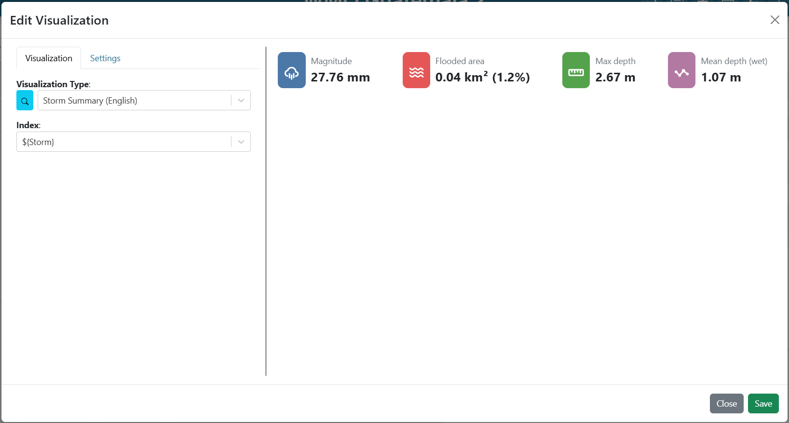

.. Solución del ejercicio práctico 2 de Guatemala, español. La versión en inglés
.. está junto a este archivo como exercise_2_en.rst.

==============================================================
Ejercicio 2: Impacto probable de un ciclo de pronóstico
==============================================================

Construcción de **Guatemala Práctica 2 (Español)**, paso a paso.

Recuerde que la interfaz está en inglés, así que los nombres
de botones y campos se dejan en inglés y en negrita.

.. contents:: En esta página
   :depth: 2
   :local:
   :backlinks: none

Qué va a construir
==================

Un mapa a la izquierda que muestra cada edificio y carretera coloreado según la
profundidad de inundación que probablemente alcance; a la derecha, una tabla y
una tarjeta que resumen ese mismo pronóstico. Dos variables en la parte superior
controlan todo: un desplegable **Date** que elige el ciclo de TITO, y que se abre
en el ciclo de muestra, y un número **Probabilidad** que define qué tan seguro
debe ser el pronóstico. Al cambiar cualquiera de los dos, la capa, la tabla y la
tarjeta se vuelven a calcular.

   **Captura:** el tablero terminado, con las variables Date y Probabilidad, el
   mapa, la tabla resumen y la tarjeta.

Para cada edificio y carretera, un ciclo de TITO publica la probabilidad de que el
agua alcance 10, 30, 70 y 100 cm. La *profundidad probable* de un elemento es la
más profunda de esas que alcanza con al menos la probabilidad elegida. Con una
Probabilidad de 0.5, un edificio con probabilidad 0.6 de llegar a 30 cm y 0.4 de
llegar a 70 cm se colorea como 0.3 - 0.7 m.

Ideas nuevas en este ejercicio: un desplegable cuyas opciones vienen de un módulo,
una capa vectorial cuyos elementos los produce un módulo en lugar de descargarse
de una URL, y dos variables de entrada que controlan tres elementos a la vez.

**Consejo:** ``notebooks/Guatemala/02_storm_impact_es.ipynb`` muestra en Python
cómo se muestrea la profundidad sobre cada edificio y carretera y cómo se arma una
tabla resumen. El cuaderno todavía usa los archivos de capacitación anteriores,
así que sus números difieren de los de este tablero.

Paso 1: Crear el tablero
========================

#. Cree un tablero nuevo (vea
   `Crear un tablero <getting_started_es.rst#crear-un-tablero>`_) con:

   * **Name**: ``Guatemala Práctica 2 (Español)``
   * **Description**: ``Pronóstico en vivo de TITO para Santa Inés Petapa: profundidad probable de inundación en edificios y carreteras para el ciclo y la probabilidad elegidos``

#. Busque su tablero en la página de inicio y haga doble clic para abrirlo. El
   tablero está vacío, así que la previsualización muestra un lienzo en blanco.

#. Abra **Dashboard Settings** en la esquina superior derecha y active
   **Unrestricted Grid Item Movement**. Guarde la configuración.

#. Salga de **Dashboard Settings** y haga clic en **Edit Dashboard**, en la
   esquina superior derecha, para entrar en modo de edición.

Paso 2: Agregar el selector de ciclo
====================================

#. Verá un elemento que ya existe en el tablero. Haga clic en el menú de 3 puntos
   del elemento y seleccione **Edit**.

#. Ponga **Visualization Type** en **Guatemala: Ciclos Disponibles** (en el grupo
   **UFFIS: Guatemala**).

#. Complete:

   .. list-table::
      :header-rows: 1
      :widths: 32 68

      * - Argumento
        - Valor
      * - ``inicio``
        - **Ciclo de muestra más reciente** (``sample``)

   Deje ``mostrar_etiqueta`` y ``texto_etiqueta`` con sus valores por defecto.

   Este elemento es una variable de entrada construida por un módulo. Publica una
   variable llamada ``Date`` y llena su desplegable con cada ciclo en vivo de TITO
   que sigue publicado, del más reciente al más antiguo, seguido de los ciclos de
   muestra, marcados con ``MUESTRA`` (por ejemplo
   ``2026-10-16 22:00 UTC, MUESTRA``). Cada valor es la marca del ciclo que usan
   las URL, como ``20261016.220000``.

   ``inicio`` define en qué opción se abre el desplegable. ``sample`` lo abre en el
   ciclo de muestra más reciente, de modo que el tablero muestra el mismo evento en
   cada sesión. **Último ciclo en vivo** (``latest``) lo abre en el ciclo en vivo
   más reciente; los ciclos en vivo se conservan poco tiempo, y un ciclo sin
   pronóstico de inundación no tiene nada que mostrar.

#. Guarde el elemento haciendo clic en **Save**, en la esquina inferior derecha del
   editor del elemento.

#. Arrastre el elemento a la parte superior del tablero y cambie su tamaño según
   haga falta. Deje espacio a su izquierda para el selector de mapa base.

#. Guarde el tablero haciendo clic en **Save Changes**, en la esquina superior
   derecha del editor del tablero.

   **Captura:** los argumentos de **Guatemala: Ciclos Disponibles**, con
   ``inicio`` en **Ciclo de muestra más reciente**.

Paso 3: Agregar la variable de probabilidad
===========================================

#. Ponga el tablero en modo de edición haciendo clic en el botón
   **Edit Dashboard**, en la esquina superior derecha.

#. Agregue otro elemento haciendo clic en **Add Dashboard Item**, en la esquina
   superior derecha.

#. Haga clic en el menú de 3 puntos del elemento nuevo y seleccione **Edit**.

#. Ponga **Visualization Type** en **Variable Input** (en el grupo **Default**).

#. Complete:

   .. list-table::
      :header-rows: 1
      :widths: 32 68

      * - Argumento
        - Valor
      * - ``variable_name``
        - ``Probabilidad``
      * - ``show_label``
        - ``True``
      * - ``variable_options_source``
        - ``number``

   La solución entregada limita el número al rango de 0.05 a 1, con pasos de
   0.05.

#. Ponga el valor inicial en ``0.5`` desde la previsualización, en el lado derecho
   del editor.

   Un elemento solo cuenta como que alcanza una profundidad si al menos esta
   fracción de los 50 miembros del conjunto pone esa cantidad de agua sobre él.
   Con 0.5 eso significa al menos la mitad. Si la baja, aparecen más elementos y
   en bandas más profundas; si la sube, solo quedan los más seguros.

#. Guarde el elemento haciendo clic en **Save**, en la esquina inferior derecha del
   editor del elemento.

#. Arrastre el elemento a la parte superior del tablero, a la derecha del selector
   de ciclo, y cambie su tamaño según haga falta.

#. Guarde el tablero haciendo clic en **Save Changes**, en la esquina superior
   derecha del editor del tablero.

   **Captura:** los argumentos de **Variable Input** de la variable Probabilidad,
   con ``number`` como fuente de opciones y un valor inicial de 0.5.

Paso 4: Agregar el selector de mapa base
========================================

El mapa base es una variable de entrada, para que el usuario pueda cambiarlo sin
editar nada. Construya primero la variable y después apunte el mapa a ella.

#. Ponga el tablero en modo de edición haciendo clic en el botón
   **Edit Dashboard**, en la esquina superior derecha.

#. Agregue otro elemento haciendo clic en **Add Dashboard Item**, en la esquina
   superior derecha.

#. Haga clic en el menú de 3 puntos del elemento nuevo y seleccione **Edit**.

#. Ponga **Visualization Type** en **Variable Input** (en el grupo **Default**).

#. Complete:

   .. list-table::
      :header-rows: 1
      :widths: 32 68

      * - Argumento
        - Valor
      * - ``variable_name``
        - ``Mapa Base``
      * - ``show_label``
        - ``True``
      * - ``variable_options_source``
        - ``Base Map Layers``

   ``Base Map Layers`` es una fuente de opciones incorporada: llena el desplegable
   con los mapas base que ofrece la instancia, así que no hace falta enumerarlos.

#. En la pestaña **Settings**, ponga **Background Color** en ``#ffffff``. Sin eso,
   el desplegable flota sobre el mapa sin fondo y es difícil de leer.

#. Elija un valor inicial para el desplegable desde la previsualización, en el lado
   derecho del editor. La solución entregada usa ``World Imagery``, pero cualquier
   mapa base sirve.

#. Guarde el elemento haciendo clic en **Save**, en la esquina inferior derecha del
   editor del elemento.

#. Arrastre el elemento a la esquina superior izquierda y cambie su tamaño según
   haga falta.

#. Guarde el tablero haciendo clic en **Save Changes**, en la esquina superior
   derecha del editor del tablero.

   Ya tiene un selector de mapa base en el tablero, pero todavía nada lo usa.

.. figure:: images/ex1-variable-input-basemap.png
   :alt: La configuración de la variable de entrada del mapa base
   :width: 100%

   **Captura:** los argumentos de **Variable Input** del selector de mapa base.

Paso 5: Agregar el mapa con la capa de profundidad probable
===========================================================

Los elementos de esta capa los calcula un módulo en cada solicitud. No hay una URL
de GeoJSON: el módulo lee los edificios y carreteras del ciclo elegido, calcula la
profundidad probable de cada uno y devuelve el resultado.

#. Ponga el tablero en modo de edición haciendo clic en el botón
   **Edit Dashboard**, en la esquina superior derecha.

#. Agregue otro elemento haciendo clic en **Add Dashboard Item**, en la esquina
   superior derecha.

#. Haga clic en el menú de 3 puntos del elemento nuevo y seleccione **Edit**.

#. Ponga **Visualization Type** en **Map** (en el grupo **Default**).

#. En el argumento **Base Map**, elija ``Mapa Base`` en la sección
   **Variable Inputs**, al final del desplegable. El valor pasa a ser
   ``${Mapa Base}``.

#. Junto a **Layers**, haga clic en **Add Layer**.

#. Vaya directamente a la pestaña **Source** y ponga **Source Type** en
   **Guatemala: Capa de Impacto por Tormenta**. Los módulos de capa dinámica
   aparecen en el mismo desplegable **Source Type** que GeoTIFF, listados bajo el
   grupo de su módulo.

#. Aparecen los argumentos del módulo. Complete:

   .. list-table::
      :header-rows: 1
      :widths: 30 70

      * - Argumento
        - Valor
      * - ``ciclo``
        - ``${Date}``
      * - ``probabilidad_minima``
        - ``${Probabilidad}``

   ``ciclo`` es un desplegable, así que elija ``Date`` en su sección
   **Variable Inputs**; sus opciones fijas (**Último ciclo**, **Evento de
   muestra**) atarían la capa a un solo ciclo. ``probabilidad_minima`` es un campo
   numérico, así que escriba ``${Probabilidad}``. Vea `Referenciar una variable de
   entrada <getting_started_es.rst#referenciar-una-variable-de-entrada>`_.

#. Haga clic en **Fetch plugin defaults**.

   Este es el paso que ahorra más trabajo. El método ``run()`` del módulo devuelve
   un armazón ya hecho: el nombre de la capa, la vinculación de la fuente, un
   estilo basado en reglas sobre el atributo ``banda`` (la banda de profundidad) y
   una leyenda que corresponde. Después de la descarga debería ver la capa llamada
   **Profundidad probable en edificios y carreteras**, ocho reglas de estilo y una
   leyenda **Profundidad** de cuatro entradas, nada de lo cual tuvo que escribir.
   Escribir reglas de estilo vectorial a mano es propenso a errores: una regla con
   la forma equivocada nunca coincide, en silencio, y deja todos los elementos en
   gris.

#. Revise las pestañas **Style** y **Legend** para ver lo que llegó. Los colores
   van de verde a amarillo, rojo y morado en cuatro bandas (0.1 - 0.3 m,
   0.3 - 0.7 m, 0.7 - 1 m y 1 m o más), con reglas separadas para polígonos
   (edificios) y líneas (carreteras), de modo que las carreteras reciben un trazo
   lo bastante ancho para verse.

#. Guarde la capa haciendo clic en **Create**, al pie del editor de capas.

#. En el argumento **Map Extent**, elija **Use a Custom Extent** e ingrese:

   .. code-block:: text

      -10078413.13,1629754.90,14.83

#. En la pestaña **Settings**, ponga **Background Color** en ``#ffffff`` y agregue
   un borde en los cuatro lados.

   Este mapa *no* ocupa toda la ventana: la comparte con la tabla y la tarjeta, así
   que deje **Fill Viewport** desactivado.

#. Guarde el elemento haciendo clic en **Save**, en la esquina inferior derecha del
   editor del mapa.

#. Cambie el tamaño del elemento del mapa para que ocupe la mitad izquierda de la
   ventana, arrastrando el controlador de su esquina inferior derecha.

#. Si el mapa está cubriendo las tres variables, haga clic en el menú de 3 puntos,
   pase el cursor sobre **Order** y seleccione **Send to Back**. Las variables
   deberían quedar visibles sobre el mapa.

#. Guarde el tablero haciendo clic en **Save Changes**, en la esquina superior
   derecha del editor del tablero.

   **Captura:** la pestaña **Source** con **Guatemala: Capa de Impacto por
   Tormenta** seleccionada, ``ciclo`` vinculado a ``${Date}``,
   ``probabilidad_minima`` vinculado a ``${Probabilidad}`` y el botón
   **Fetch plugin defaults**.

   **Captura:** la pestaña **Style** después de la descarga, mostrando las ocho
   reglas sobre el atributo ``banda``.

Paso 6: Agregar la tabla resumen
================================

#. Ponga el tablero en modo de edición haciendo clic en el botón
   **Edit Dashboard**, en la esquina superior derecha.

#. Agregue otro elemento haciendo clic en **Add Dashboard Item**, en la esquina
   superior derecha.

#. Haga clic en el menú de 3 puntos del elemento nuevo y seleccione **Edit**.

#. Ponga **Visualization Type** en **Guatemala: Resumen de Impacto por Tormenta**
   (en el grupo **UFFIS: Guatemala**).

#. Complete los mismos dos argumentos que en la capa:

   .. list-table::
      :header-rows: 1
      :widths: 30 70

      * - Argumento
        - Valor
      * - ``ciclo``
        - ``${Date}``
      * - ``probabilidad_minima``
        - ``${Probabilidad}``

   La tabla divide los elementos inundados en las mismas cuatro bandas de
   profundidad probable, de la más profunda a la menos profunda, más una fila
   **TOTAL afectado**, con el número de edificios, la población, el área, la
   longitud de carretera y la proporción de la población afectada. El título
   indica la probabilidad y el ciclo, por ejemplo
   ``Profundidad probable, probabilidad ≥ 50% (2026-10-16 22:00 UTC, MUESTRA)``.
   Un ciclo de TITO no trae una cifra de censo, así que la proporción se calcula
   sobre la gente de los propios edificios del sitio.

#. Guarde el elemento haciendo clic en **Save**, en la esquina inferior derecha del
   editor del elemento.

#. Arrastre el elemento a la derecha del mapa y cambie su tamaño según haga falta.

#. Guarde el tablero haciendo clic en **Save Changes**, en la esquina superior
   derecha del editor del tablero.

Paso 7: Agregar la tarjeta del pronóstico
=========================================

#. Ponga el tablero en modo de edición, agregue otro elemento y abra su menú de
   3 puntos y seleccione **Edit**, igual que en el paso anterior.

#. Ponga **Visualization Type** en **Guatemala: Resumen de Tormenta** (en el grupo
   **UFFIS: Guatemala**).

#. Complete otra vez los mismos dos argumentos: ``ciclo`` = ``${Date}`` y
   ``probabilidad_minima`` = ``${Probabilidad}``.

   La tarjeta da las cifras principales para quien no va a leer una tabla: la
   lluvia pronosticada (la mediana y el miembro más lluvioso del conjunto), el
   área inundada con al menos 0.1 m a la probabilidad elegida, y las personas y
   edificios que se espera reciban al menos 0.3 m de agua. Cuando un ciclo no
   activó un pronóstico de inundación para el sitio, la tarjeta muestra en su
   lugar una sola línea de estado.

#. Guarde el elemento haciendo clic en **Save**, en la esquina inferior derecha del
   editor del elemento.

#. Arrastre el elemento debajo de la tabla resumen y cambie su tamaño según haga
   falta.

#. Guarde el tablero haciendo clic en **Save Changes**, en la esquina superior
   derecha del editor del tablero.

   **Captura:** la tabla resumen y la tarjeta para el ciclo de muestra con una
   Probabilidad de 0.5.

Paso 8: Probar las conexiones
=============================

Cambie la Probabilidad. La capa, la tabla y la tarjeta deberían actualizarse, con
mensajes de progreso mientras la capa se recalcula. La lluvia de la tarjeta no
cambia, porque no depende de la probabilidad.

Después elija un ciclo en vivo en el desplegable Date. Los tres elementos vuelven
a leer ese ciclo. Un ciclo sin pronóstico de inundación para el sitio da una capa
vacía y una tarjeta con solo una línea de estado. Vuelva al ciclo de muestra al
terminar.

Punto de control
================

A estas alturas debería tener:

* Un desplegable Date que se abre en ``2026-10-16 22:00 UTC, MUESTRA``.
* Con una Probabilidad de 0.5 en el ciclo de muestra: 704 edificios y carreteras
  coloreados; una tabla cuya fila **TOTAL afectado** muestra 543 edificios y
  1,644 personas; y una tarjeta con 21 / 36 mm de lluvia, 0.13 km² inundados y
  1,178 personas esperadas con al menos 0.3 m.
* Al cambiar la Probabilidad o la fecha se actualizan la capa, la tabla y la
  tarjeta: los tres.
* Un control de capas con dos capas (incluido el mapa base).
* La capa coloreada por profundidad probable, con una leyenda **Profundidad**, y
  las carreteras visibles como líneas de color y no como hilos.

Puntos de discusión
===================

* **Dos variables, tres consumidores.** ``${Date}`` y ``${Probabilidad}``
  aparecen cada una en el argumento de una capa de módulo y en los argumentos de
  dos visualizaciones. Ninguno de los tres elementos sabe de los otros; todos
  simplemente declaran que dependen de un nombre.
* **Muestra frente a ciclo en vivo.** El ciclo de muestra tiene exactamente la
  estructura de uno en vivo, así que este tablero ya es un tablero en vivo: solo
  cambia la fecha. La muestra existe porque los ciclos en vivo aparecen y
  desaparecen rápido y uno tranquilo no tiene nada que mostrar, lo que lo hace un
  mal ejercicio.
* **Dos formas de contar personas.** Las 1,644 personas de la tabla son toda la
  gente de los edificios cuya profundidad probable es de al menos 0.1 m a la
  probabilidad elegida. Las 1,178 de la tarjeta son un número *esperado*: cada
  persona cuenta según su propia probabilidad de 0.3 m, así que la cifra no se
  mueve con la variable Probabilidad. Responden preguntas distintas, y vale la
  pena mostrar ambas.
* **Las capas dinámicas se vuelven a ejecutar.** Cada cambio vuelve a ejecutar
  código de Python que lee los archivos del ciclo y clasifica cada edificio y
  carretera del sitio, y por eso el módulo informa su progreso mientras trabaja.
* **Por qué el módulo entrega un estilo.** La alternativa, escribir a mano ocho
  reglas en la interfaz, falla en silencio cuando una regla está mal formada.
  Entregar el estilo desde ``run()`` hace que la capa esté correcta desde la
  primera vez y siga estándolo si cambian las bandas.

Posiciones de los elementos
===========================

La solución entregada coloca sus elementos así, en la cuadrícula de 100 columnas:

.. list-table::
   :header-rows: 1
   :widths: 40 15 15 15 15

   * - Elemento
     - ``x``
     - ``y``
     - ``w``
     - ``h``
   * - Mapa
     - 0
     - 0
     - 54
     - 38
   * - Variable Mapa Base
     - 0
     - 0
     - 15
     - 6
   * - Selector de ciclo (Date)
     - 15
     - 0
     - 20
     - 6
   * - Variable Probabilidad
     - 42
     - 0
     - 12
     - 6
   * - Tabla resumen
     - 54
     - 2
     - 45
     - 26
   * - Tarjeta del pronóstico
     - 54
     - 23
     - 46
     - 13

Siguiente
=========

`Ejercicio 3: Clasificación de peligro con umbrales ajustables
<exercise_3_es.rst>`_ pone los umbrales mismos en manos del usuario.
