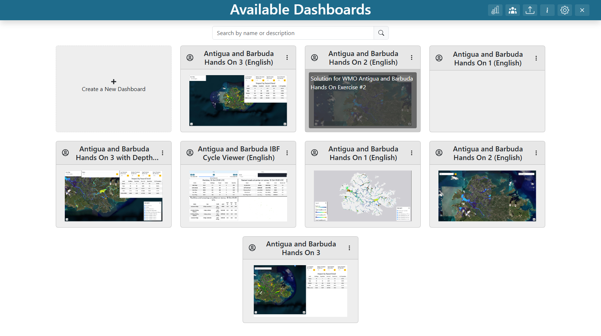
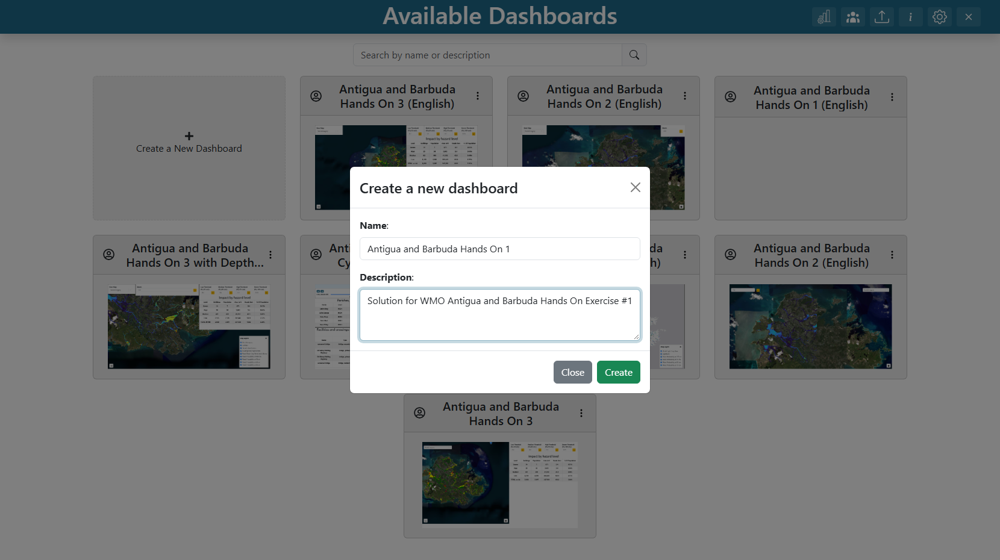
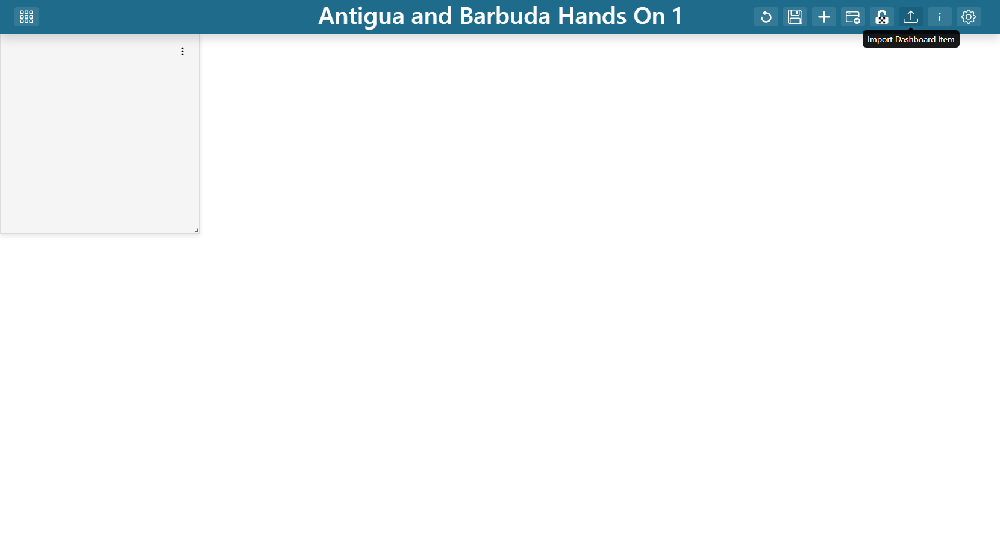
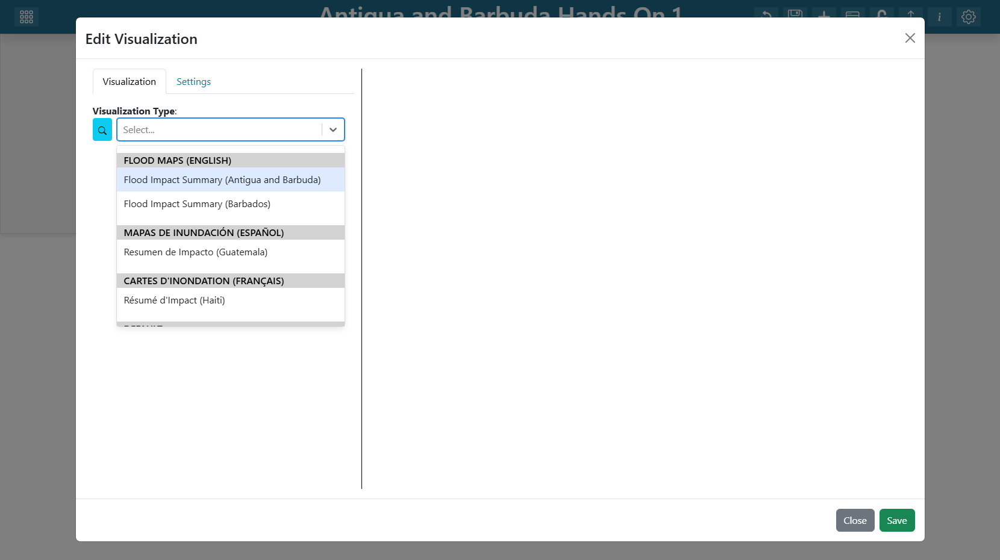
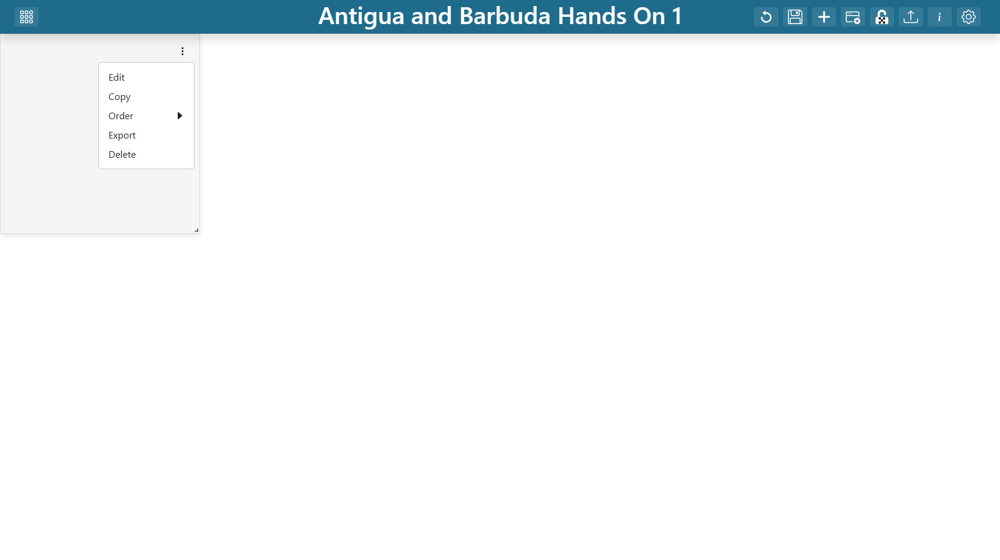

.. Portada compartida de las guías de ejercicios prácticos de Guatemala, español.
.. La versión en inglés está junto a este archivo como getting_started_en.rst.

==============================================================
Ejercicios Prácticos de Guatemala: Para Empezar
==============================================================

Instalación, contexto y los pasos que se repiten en todos los ejercicios. Lea esta
página una vez y luego trabaje el ejercicio que necesite.

**Nota sobre el idioma:** La interfaz de TethysDash está en inglés. Por eso los
nombres de botones, pestañas y campos se dejan en inglés y **en negrita**
(**Add Layer**, **Save Changes**), tal como aparecen en la pantalla. El texto
explicativo está en español.

.. contents:: En esta página
   :depth: 2
   :local:
   :backlinks: none

Los tres ejercicios
===================

Cada ejercicio construye un tablero de visualización y tiene su propio archivo:

.. list-table::
   :header-rows: 1
   :widths: 30 22 48

   * - Guía
     - Tablero
     - Qué muestra
   * - `Ejercicio 1: Un mapa de probabilidad de inundación <exercise_1_es.rst>`_
     - Guatemala Práctica 1 (Español)
     - Cuatro rásteres de probabilidad de excedencia del ciclo de muestra de TITO
       en un solo mapa, con un mapa base intercambiable.
   * - `Ejercicio 2: Impacto probable de un ciclo de pronóstico <exercise_2_es.rst>`_
     - Guatemala Práctica 2 (Español)
     - La profundidad probable de inundación sobre cada edificio y carretera para
       el ciclo de TITO y la probabilidad elegidos, con una tabla resumen y una
       tarjeta con las cifras principales.
   * - `Ejercicio 3: Clasificación de peligro con umbrales ajustables <exercise_3_es.rst>`_
     - Guatemala Práctica 3 (Español)
     - Una clasificación de peligro controlada por cuatro umbrales de probabilidad
       que el usuario puede mover, con los edificios y carreteras afectados y una
       tabla de impacto.

Los ejercicios son acumulativos en dificultad, no en contenido: cada uno es un
tablero independiente y se puede construir por separado. El ejercicio 1 enseña las
capas ráster, el 2 agrega una capa vectorial generada por un módulo y un
selector alimentado por datos, y el 3 agrega interactividad mediante variables de
entrada.

Cuadernos complementarios
-------------------------

``notebooks/Guatemala/02_storm_impact_es.ipynb`` y
``notebooks/Guatemala/03_hazard_classification_es.ipynb`` derivan en Python los números que
están detrás de los ejercicios 2 y 3. Estas guías tratan de *cómo construir el
tablero*; los cuadernos tratan de *por qué los números son los que son*. Se
complementan bien: ejecute el cuaderno primero si quiere entender el análisis, y
siga la guía si quiere armar la interfaz.

Los cuadernos todavía trabajan con los archivos de capacitación anteriores y no
con el ciclo de muestra de TITO que ahora leen los tableros, así que sus números
difieren de los que muestran los tableros.

Convenciones
------------

* La **negrita** marca algo en lo que se hace clic, o la etiqueta de un campo tal
  como aparece en la interfaz, por ejemplo **Add Layer** o **Source Type**.
* El ``monoespaciado`` marca un valor que se escribe o se pega.
* Los pasos están numerados. Cuando el orden no importa, se dice explícitamente.
* Cada ejercicio termina con un **Punto de control** que enumera lo que debería
  poder ver, y con **Puntos de discusión** que vale la pena mencionar si usted es
  quien enseña.

**Nota:** Las capturas de pantalla de estas guías son marcadores de posición.
Cada bloque ``figure`` describe lo que debe mostrar la imagen; coloque un PNG en
la ruta indicada dentro de ``docs/Guatemala/images/`` y se mostrará.

Antes de empezar
================

Lo que necesita
---------------

#. **Una instancia de TethysDash donde pueda crear tableros.** Debe poder llegar a
   la página de inicio y crear un tablero, lo que implica una cuenta con permiso
   para crear tableros.
#. **El paquete** ``tgf_wmo_plugins`` **instalado en el servidor**, no solo en su
   computadora. Los módulos de visualización se descubren en el backend mediante
   los puntos de entrada de Intake, así que el proceso de la aplicación debe poder
   importarlos:

   .. code-block:: bash

      pip install git+https://github.com/Aquaveo/tgf_wmo_plugins.git

   Reinicie la aplicación de Tethys después de instalar. Para confirmar que
   funcionó, abra el desplegable **Visualization Type** de cualquier elemento del
   tablero y busque el grupo **UFFIS: Guatemala**.
#. **Salida HTTPS desde el servidor.** Cada módulo lee sus datos del servidor
   público de TITO en el momento de la solicitud. Nada viene incluido en el
   paquete.
#. **Permisos de visualización**, si su instancia restringe los tipos de módulo.
   Los ejercicios usan los tipos ``table``, ``card``, ``map_layer`` y
   ``variable_input``.
#. **Nombres de los módulos en español.** Los módulos de Guatemala hablan español
   sea cual sea el idioma del tablero: sus etiquetas, nombres de argumentos,
   nombres de capas y nombres de atributos están en español. Las guías en inglés
   usan los mismos módulos.

**Advertencia:** Si el grupo **UFFIS: Guatemala** no aparece en el
desplegable, el paquete no está instalado en el entorno donde realmente se ejecuta
la aplicación. Este es, por mucho, el problema de instalación más común. Instalarlo
en el Python de su terminal no es suficiente cuando la aplicación corre bajo otro
intérprete o en otro contenedor.

Los datos
---------

Los tres tableros leen un mismo **ciclo de muestra** de TITO: el pronóstico
publicado el 2026-10-16 a las 22:00 UTC para el sitio de Santa Inés Petapa, que se
conserva como ejemplo fijo para que los ejercicios muestren el mismo evento en
cada sesión. Su raíz es:

.. code-block:: text

   https://tito.uffis.org/sample/guatemala/20261016.220000/

Un ciclo de muestra tiene la misma estructura que las salidas en vivo de TITO, que
se publican en ``https://tito.uffis.org/outputs/guatemala/<ciclo>/``. Por eso,
cualquier cosa construida sobre la muestra funciona con un ciclo en vivo con solo
cambiar el ciclo.

.. list-table::
   :header-rows: 1
   :widths: 26 74

   * - Lo usa
     - Contenido
   * - Capas del mapa (ejercicios 1 y 3)
     - Los cuatro GeoTIFF de probabilidad de excedencia, en
       ``guatemala_90m/fim/stream_sat_stormlab/Guatemala_SantaInesPetapa/combined_overbank/``
       dentro de la raíz, con el nombre
       ``prob_depth_ge_<profundidad>_overbank.20261016.220000.tif`` para
       ``<profundidad>`` = ``10cm``, ``30cm``, ``70cm`` y ``100cm``. Cada celda
       contiene la probabilidad de que el agua alcance esa profundidad.
   * - Módulos (ejercicios 2 y 3)
     - Los edificios, carreteras y probabilidades del mismo ciclo. Los módulos los
       encuentran por sí mismos; usted solo les indica qué ciclo leer.

Las probabilidades son fracciones de 50 miembros del conjunto, así que cada valor
es múltiplo de 0.02, y cada uno de los cuatro rásteres llega a 1.0 en algún punto.
Los rásteres tienen 424 x 319 celdas de unos 5 m.

Las versiones anteriores de estos ejercicios leían archivos de capacitación de un
bucket de S3 (``PBI_Actividad_2/``, ``Guatemala_IBF/`` y ``floodmaps_test/``). Los
tableros de los ejercicios ya no los usan; los cuadernos complementarios sí.

**Importante:** Los rásteres de la muestra están de origen en **EPSG:3857**, y eso
importa. TethysDash no incluye proj4, por lo que OpenLayers solo puede resolver
EPSG:4326 y EPSG:3857 para los datos de una capa. Si apunta una capa a un ráster en
otra proyección (por ejemplo, uno en UTM), parecerá cargar y luego desaparecerá, o
arrastrará todo el mapa a coordenadas equivocadas. Si una capa aparece y
desaparece, revise primero su proyección.

Pasos comunes a los tres ejercicios
===================================

Estos pasos se repiten en todos los ejercicios. Se explican una sola vez aquí, y
los ejercicios se refieren a ellos como "crear el tablero" y "agregar un elemento
al tablero".

Crear un tablero
----------------

#. En la página de inicio, haga clic en la tarjeta **Create a New Dashboard**.
#. Complete **Name** y **Description**, y luego haga clic en **Create**.
#. El tablero nuevo se abre vacío.

   **Captura:** la página de inicio, con la tarjeta **Create a New Dashboard** a
   la vista.

   **Captura:** la ventana de tablero nuevo, con Name y Description completados.

Entrar en modo de edición
-------------------------

Un tablero solo puede ser modificado por su propietario, y solo en modo de
edición. Haga clic en el botón **Edit Dashboard** en el encabezado. El encabezado
ofrece entonces lo siguiente:

.. list-table::
   :header-rows: 1
   :widths: 34 66

   * - Botón
     - Qué hace
   * - **Add Dashboard Item**
     - Agrega un elemento nuevo, sin configurar, a la distribución.
   * - **Lock/Unlock Movement**
     - Fija la posición de los elementos para que pueda hacer clic sin arrastrar.
   * - **Import Dashboard Item**
     - Carga un elemento desde un archivo de configuración exportado.
   * - **Dashboard Settings**
     - Nombre, descripción, miniatura, opciones para compartir, notas y
       **Unrestricted Grid Item Movement**.
   * - **Save Changes**
     - Guarda la distribución.
   * - **Cancel**
     - Descarta los cambios y vuelve al último guardado.

   **Captura:** la barra de herramientas del encabezado en modo de edición, con
   los botones anteriores a la vista.

**Consejo:** Guarde con frecuencia. **Cancel** revierte al último guardado, así
que una sesión larga de edición sin guardar está a un solo error de perderse.

Agregar y configurar un elemento del tablero
--------------------------------------------

#. En modo de edición, haga clic en **Add Dashboard Item**. Aparece un elemento
   vacío.
#. Haga clic en el **menú de 3 puntos** del elemento y seleccione **Edit**. Se
   abre la ventana del visor de datos.
#. En la pestaña **Visualization**, elija un **Visualization Type**. Debajo
   aparecen los argumentos de esa visualización.
#. Complete los argumentos. La previsualización se actualiza a medida que avanza.
#. Cambie a la pestaña **Settings** para las opciones del elemento: bordes, color
   de fondo, **Fill Viewport**. Las opciones solo están disponibles una vez que la
   visualización está configurada y previsualizándose.
#. Haga clic en **Save**, en la esquina inferior derecha del editor del elemento,
   para aplicar los cambios; después haga clic en **Save Changes**, en la esquina
   superior derecha del editor del tablero, para guardarlos.

   **Captura:** el visor de datos con el desplegable **Visualization Type**
   abierto, mostrando el grupo **UFFIS: Guatemala**.

   **Captura:** el menú de 3 puntos de un elemento, mostrando Edit, Copy, Order,
   Export y Delete.

Dimensionar y ubicar los elementos
----------------------------------

Arrastre un elemento por su cuerpo y cambie su tamaño desde el controlador de la
esquina inferior derecha. La cuadrícula tiene 100 columnas de ancho. Las tres
soluciones activan **Unrestricted Grid Item Movement** (en **Dashboard
Settings**), que permite colocar los elementos en cualquier lugar y superponerlos;
aquí es necesario para que los controles y los paneles puedan flotar sobre un mapa
a pantalla completa.

Cada ejercicio termina con una tabla de **Posiciones de los elementos** que indica
los valores exactos de ``x``, ``y``, ``w`` y ``h`` de cada elemento de esa
solución. No hace falta reproducirlos al píxel: arrastre a una posición parecida y
ajuste.

Referenciar una variable de entrada
-----------------------------------

Los tres ejercicios conectan visualizaciones a variables de entrada. Hay dos
formas de escribir la referencia, según el argumento:

* Los **argumentos de tipo desplegable** enumeran las variables disponibles en una
  sección **Variable Inputs** al final del desplegable: elíjala de allí.
* Los **argumentos de texto libre** usan la sintaxis de plantilla
  ``${Nombre de la Variable}``, escrita a mano.

El nombre dentro de las llaves debe coincidir exactamente con el ``variable_name``
de la variable de entrada, incluidos los espacios y la puntuación. Construya la
variable de entrada *antes* de los elementos que la referencian, o no habrá nada
que seleccionar.

Importar una solución terminada
===============================

Para reiniciar entre sesiones, o para verificar su trabajo, los tableros
terminados están en este repositorio dentro de ``dashboards/``:

.. code-block:: text

   dashboards/Guatemala/Guatemala_Hands_On_1.json
   dashboards/Guatemala/Guatemala_Hands_On_2.json
   dashboards/Guatemala/Guatemala_Hands_On_2_English.json
   dashboards/Guatemala/Guatemala_Hands_On_3.json

``Guatemala_Hands_On_1.json``, ``_2.json`` y ``_3.json`` son las soluciones en
español, las que construyen estas guías.

``Guatemala_Hands_On_2_English.json`` es un tablero en inglés más completo de
pronóstico en vivo. Su primera pestaña contiene los elementos del ejercicio 2
(desplegable de ciclos, variable ``Probability``, capa de profundidad probable,
tarjeta y tabla) junto con elementos de peligro, lluvia y caudal, y una segunda
pestaña muestra alertas.

Estos archivos son exportaciones de tableros completos. Los elementos individuales
también se pueden mover entre tableros con **Export** en el menú de 3 puntos de un
elemento y **Import Dashboard Item** en el encabezado, que es la forma más rápida
de reutilizar las cuatro capas ráster del ejercicio 1 en el ejercicio 3.

Solución de problemas
=====================

.. list-table::
   :header-rows: 1
   :widths: 40 60

   * - Síntoma
     - Causa y solución
   * - El grupo **UFFIS: Guatemala** no aparece en
       **Visualization Type**.
     - ``tgf_wmo_plugins`` no está instalado en el entorno donde corre la
       aplicación, o la aplicación no se reinició. Instálelo en el servidor y
       reinicie.
   * - Una visualización dice que una variable está vacía.
     - El nombre en ``${...}`` no coincide exactamente con un ``variable_name``, o
       la variable de entrada se agregó después del elemento que la referencia.
       Revise la ortografía, los espacios y la puntuación, y vuelva a seleccionar
       la variable.
   * - Una capa aparece y luego desaparece.
     - Casi siempre es un problema de proyección. Confirme que el ráster está en
       EPSG:3857 o EPSG:4326. Los rásteres de la muestra están en EPSG:3857; un
       ráster en UTM no.
   * - Todo el mapa salta a algún lugar de África.
     - La misma causa. Un GeoTIFF en una proyección que no se puede resolver hace
       que el ajuste automático adopte coordenadas que caen cerca de 0°, 0°.
   * - Todos los elementos vectoriales se ven grises.
     - Las reglas de estilo no coinciden. Use **Fetch plugin defaults** en lugar de
       escribir las reglas a mano; una regla mal formada nunca coincide y falla en
       silencio.
   * - Un ráster se ve de un solo color plano.
     - Los límites de la rampa no corresponden a los datos, o ``mask_below`` no
       está definido y por eso se está coloreando el suelo seco. Revise ambos.
   * - Una capa o tabla de un módulo está vacía, o muestra un evento distinto
       del de las capas ráster.
     - El ciclo del módulo no es la muestra. En el ejercicio 3 ponga ``ciclo`` en
       **Evento de muestra** (``sample``); en el ejercicio 2 vincúlelo a
       ``${Date}`` y elija el ciclo de muestra. Si se deja sin definir, el módulo
       lee el último ciclo en vivo, en el que puede que no haya habido
       inundación.
   * - El desplegable **Date** del ejercicio 2 se abre en un ciclo en vivo.
     - El argumento ``inicio`` de la lista de ciclos no está definido. Póngalo en
       **Ciclo de muestra más reciente** (``sample``).
   * - El tablero no se puede editar.
     - Solo el propietario puede editar, y solo en modo de edición. Busque el botón
       **Edit Dashboard** en el encabezado.
